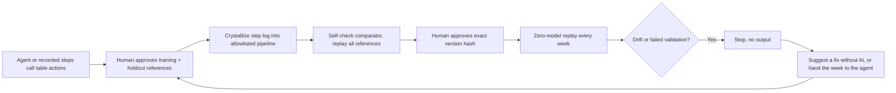

# Rote

**Teach it once. Never pay for it again.**

Rote turns a data job an AI agent keeps repeating into a verified, versioned pipeline that replays with zero model calls, and stops instead of guessing when the input changes. Built on [Agent-Native](https://agent-native.com) for the Builder.io Agent-Native Hackathon.

**Live demo:** https://rote-demo.netlify.app (no sign-in; shared data reset hourly)

## The numbers (recorded, not estimated)

| Same job, same laptop (4 Nov 2026) | Time | Model tokens | Model calls |
| --- | --- | --- | --- |
| Agent does the payout reconciliation (Gemini 3.1 Flash-Lite, guided) | 42.1 s | 242,036 | 12 |
| Rote replays the next week from the approved pipeline | 19.6 ms | 0 | 0 |
| Rote explains and repairs a changed bank export | 34.3 ms | 0 | 0 |

Every output matched an independently generated reference. One run each; see `docs/live-acceptance-2026-11-04.md` and `benchmark/live-acceptance.json`.

**Real public data:** India CDSCO "Not of Standard Quality" drug alerts. Taught on January 2026 (218 rows), verified on February (217), March (190 rows) replayed with 0 model tokens and matching an independent reference. See `docs/data-cdsco.md`.

## Try it in two minutes

1. Open the demo and click **Start the guided demo**.
2. Approve the reference and the unseen holdout, then **Crystallize**, **Verify** (Rote first proves its comparator rejects a changed value and a dropped row) and **Approve and activate** the exact version hash.
3. **Run approved pipeline**: next week replays with "0 model tokens".
4. **Teach the new format → bank changes its export → Run**: the run stops on drift. **Suggest a fix (no AI)** explains the renamed column and the new date format without a model.
5. Back on Home, **Or ask the agent → Run this week's payouts**: the agent checks for an approved pipeline and calls `run-task` instead of redoing the job.
6. **Recurring tasks → Real data: CDSCO drug alerts** runs the same loop on real data.

The demo agent runs on Gemini's free tier with a shared limit of 8 requests per hour; Google's free models are sometimes slow or briefly unavailable. Everything except the chat runs without a model.

## How it works



- The agent does the job with 15 bounded table actions (select, rename, parse date/number, normalize, regex extract, map values, filter, dedupe, join, group/aggregate, sort, compute column, split, validate). Every call is recorded with its inputs and outputs.
- Crystallizing extracts an allowlisted step DAG from that recorded lineage. A pipeline is data, not generated code. Its canonical hash binds it.
- Verification freezes the references and tolerances, self-tests the comparator, then replays the training example and an independent holdout. Approved holdout rows are hidden from agent, MCP, A2A and CLI callers.
- `run-task` checks each input's schema fingerprint, replays, validates and persists the output with version attribution. Drift or a failed validation writes nothing.
- **Restraint.** Before working, the agent calls `list-tasks` and uses `run-task` when an approved pipeline covers the job. On drift it calls `propose-drift-fix` first. The restraint report on Home shows which repeated agent work (from framework traces) is not covered by a pipeline yet.

## Agent-Native features used

| Capability | Where | Status |
| --- | --- | --- |
| One action layer for UI, agent, CLI and MCP | `actions/`, `server/rote/steps.ts` | 15 step actions plus the task lifecycle; tested |
| MCP | `mcpTool: true` on `run-task`, `list-tasks`, `get-task`, `list-tables` | `tools/call run-task` verified locally |
| Agent chat with screen context and hand-off | `server/plugins/agent-chat.ts`, `app/routes/tasks.tsx`, `app/routes/home.tsx` | Live on the demo |
| Human approval | `approve-example`, `promote-pipeline` (`needsApproval: true`) | Framework approval gates |
| Observability | `server/rote/trace-evidence.ts`, `server/rote/restraint.ts` | Agent tokens, time and calls come from completed framework traces; replays record zero |
| Durable background agent runs | Netlify background function (`A2A_SECRET`) | Verified on the demo |
| Public demo mode | `server/rote/demo.ts`, `server/rote/demo-agent.ts` | Hourly reset; server-side hourly cap on agent turns |

## Benchmarks

`./scripts/local pnpm benchmark` teaches each synthetic sample task once, replays 18 unseen weeks through the persisted `run-task` path (in-memory PGlite with the app's migrations) and checks every output against the generator's independent reference. Latest run (`benchmark/results.json`, Apple M4, 5 Nov 2026 IST):

| Task | Unseen weeks correct | Replay median / p95 | Model tokens per replay | Drift cases stopped |
| --- | --- | --- | --- | --- |
| Batched payout reconciliation | 18/18 | 2.5 / 3.5 ms | 0 | 3/3 |
| Vendor price-list cleanup | 18/18 | 1.6 / 2.1 ms | 0 | 3/3 |

On the hosted demo (Netlify functions + Neon) the same replays take tens to about 140 ms because of database round trips.

## Honest limits

- The teaching run was **guided**: the prompt named the steps. The model executed them and wired the real table IDs; it did not discover the reconciliation logic itself. A separate **unguided** run on real CDSCO data (goal only, no steps named) got batch, product, manufacturer, expiry and reporter right for 215–218 of 218 rows but categorized the failed test for only 46 rows, which is why every agent run stays a draft until a person approves it and an unseen holdout passes (`docs/unguided-run-2026-11-05.md`).
- CDSCO January steps were recorded by a script, not an agent run. Its references come from an independent plain-code implementation of the same written rules. Some published addresses have no comma after the company name, so those manufacturer names keep part of the address.
- Deterministic repair covers renamed columns and changed date formats only; anything else stops for a person.
- No scheduling yet.

## Local setup

```sh
cd ~/rote
sh scripts/bootstrap
cp -n .env.example .env
# Edit .env yourself: set GOOGLE_GENERATIVE_AI_API_KEY from a billing-disabled project.
./scripts/local pnpm dev --host 127.0.0.1
```

Open the printed URL and use **Continue as local dev**. Local data lives in PGlite under the ignored `data/` folder; do not set `DATABASE_URL` locally. The configured model is `gemini-3.1-flash-lite`; check its free quota on your own project.

```sh
./scripts/local pnpm typecheck
./scripts/local pnpm test
./scripts/local pnpm agent-native:doctor
./scripts/local pnpm benchmark
```

Deployment notes are in `docs/deploy.md`.

## Pre-existing work and attribution

Started on 31 October 2026 from the MIT-licensed Builder.io Agent-Native Chat template, version 0.222.2. Retained template code includes chat, authentication, navigation, settings, UI primitives and migration setup. Third-party libraries are declared in `package.json`; exact resolutions are in `pnpm-lock.yaml`. CDSCO data is public information published by the Government of India's CDSCO and is bundled with its source URL and SHA-256.

Built with AI coding assistants under Mohit's direction. A Core bug found along the way is documented with a patch in `docs/upstream/`.

## Team

Mohit Prajapati, solo builder (`mohitt31`).
