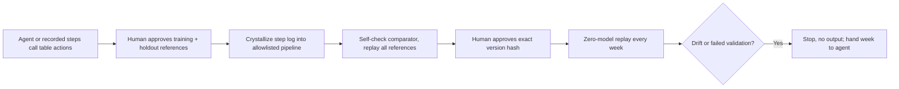

# Rote

**Teach it once. Never pay for it again.**

Rote turns repeated agent-led data jobs into verified, versioned deterministic pipelines that replay with zero model calls. Automated end-to-end tests use a mocked agent; the live model-backed teaching run remains pending.

## Current status

- Official standalone Chat template, scaffolded from `@agent-native/core@0.222.2`, with local Node 22.22.0 / pnpm bootstrap.
- Fifteen deterministic table actions, CSV/XLSX import, preview/export, scoped SQL storage and step logs (`/workbench`).
- `/tasks`: a guided five-step flow — approve a training reference and an unseen holdout → crystallize the recorded steps → verify (comparator self-check, then every frozen reference) → approve the exact version hash → replay next week with zero model calls.
- Two sample tasks with independent references: batched payout reconciliation and vendor price-list cleanup (both synthetic and labelled as sample data).
- Drift or a failed recorded validation stops the run without output; the UI can hand the stopped week to the agent chat with context.
- `run-task` works from the UI, the CLI and MCP (`tools/call` with a per-user connection token), all verified locally.
- **Not yet done:** a real model-backed agent teaching run (needs the user's Gemini key), so no agent token/cost numbers are claimed anywhere. Automated repair, re-teaching a changed format inside the same task, scheduling and deployment are also pending.

## Local setup

From this checkout, run:

```sh
cd ~/rote
sh scripts/bootstrap
cp -n .env.example .env
# Edit .env yourself: set GOOGLE_GENERATIVE_AI_API_KEY using a billing-disabled project.
./scripts/local pnpm dev --host 127.0.0.1
```

Open the printed local URL, use **Continue as local dev**, and ask: **Call the hello action for Mohit.** No account or password is needed for the local development session. The expected action result is `Hello, Mohit!`; an actual model reply still requires a working key and available model quota.

The configured model is `gemini-3.1-flash-lite`, present in the installed framework's model catalog. Its availability and free quota must be confirmed on the user's project before inference. Change `AGENT_MODEL` in `.env` or select a model in Settings. For Groq, set `GROQ_API_KEY`, `AGENT_ENGINE=ai-sdk:groq`, and an available free-tier `AGENT_MODEL`. Never assume quotas or prices from this README.

Do not set `DATABASE_URL` for local setup: PGlite stores development data under ignored `data/`. Keep `AUTH_DISABLED` unset. Hosted deployments and production migrations require explicit approval.

Useful commands:

```sh
./scripts/local pnpm typecheck
./scripts/local pnpm test
./scripts/local pnpm agent-native:doctor
./scripts/local pnpm action hello --name Mohit
```

See `docs/day-4.md` for the latest progress, `docs/day-3.md` for the core loop, and `docs/day-2.md` for primitive/import details. `docs/progress-2026-10-31.md` retains the Day 1 record.

## How it works



The verifier and reference examples are outside the editable surface of any pipeline change. Pipelines contain allowlisted step definitions, not generated executable code. Numeric tolerance must be declared by the task.

## Framework feature map

| Capability | Source | Status |
| --- | --- | --- |
| Shared actions (UI + agent + CLI + MCP) | `actions/`, `server/rote/steps.ts` | Fifteen primitives plus task lifecycle actions; tested |
| CLI | `pnpm action run-task '{"taskId":…,"inputs":{…}}'` | Verified locally (set `AGENT_ORG_ID` to the workspace org) |
| MCP | `mcpTool: true` on `run-task`, `list-tasks`, `get-task`, `list-tables` | Verified locally: `tools/list` + `tools/call run-task` with a token from `/mcp/connect` |
| Chat and context | `server/plugins/agent-chat.ts`, `actions/view-screen.ts`, drift hand-off in `app/routes/tasks.tsx` | Hand-off verified in the browser; model answer pending a key |
| Observability | `server/plugins/rote-config.ts`, `server/rote/trace-evidence.ts` | Capture configured; real model trace pending |
| Approval and audit | `actions/approve-example.ts`, `actions/promote-pipeline.ts` (`needsApproval: true`) | Framework approval gates and audit |
| Automations, evals | — | Planned; not claimed |
| Clips and Slides | Agent-Native apps | Planned |

Agent-Native already provides stored Data Programs. Rote's distinction is verification of a constrained action pipeline against approved examples and an unseen holdout, with a validated comparator and measured replay.

## Benchmarks and data

`./scripts/local pnpm benchmark` teaches each sample task once, replays 18 unseen weeks through the persisted `run-task` path (in-memory PGlite with the app's migrations) and checks every output against the generator's independent reference. Latest run (`benchmark/results.md`, sample data, cloud Xeon VM):

| Task | Unseen weeks correct | Replay median / p95 | Model tokens per replay | Drift cases stopped |
| --- | --- | --- | --- | --- |
| Batched payout reconciliation | 18/18 | 8.4 / 10.0 ms | 0 | 3/3 |
| Vendor price-list cleanup | 18/18 | 5.6 / 6.7 ms | 0 | 3/3 |

Agent-only runs have **not** been measured; the comparison column stays empty until a real traced model run exists. The separate in-memory primitive benchmark (`benchmark/primitives.json`) measured 13.62 ms median for six steps on 10,000 rows. All payout and vendor data is synthetic and labelled as sample data; CDSCO snapshots have not been fetched.

## Pre-existing work and attribution

Started on 31 October 2026 from the MIT-licensed BuilderIO Agent-Native Chat template, version 0.222.2. Retained template code includes chat, authentication, navigation, settings, UI primitives, and migration setup. Third-party libraries are declared in `package.json`; exact resolutions are recorded in `pnpm-lock.yaml`. Major libraries include React, React Router, Vite, Nitro (via Core), Drizzle, PGlite, Zod, Vercel AI SDK providers, Tailwind, Radix, TanStack Query, and Vitest. Review dependency licenses before publication.

New project work is built with AI coding assistants under Mohit's direction. Template instructions remain in `AGENTS.md`; the original product brief and permissions are in `docs/brief.md`.

## Team

Mohit Prajapati — solo builder (`mohitt31`).
