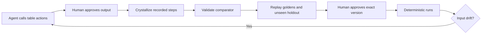

# Rote

**Teach it once. Never pay for it again.**

Rote is being built to turn repeated agent-led data jobs into verified, versioned deterministic pipelines. The Day 3 build adds a task approval, verification and deterministic replay loop. Its automated end-to-end tests use a mocked agent; the live model-and-human acceptance gate remains pending.

## Current status

- Official standalone Chat template, scaffolded from `@agent-native/core@0.222.2`.
- Local Node 22.22.0 and pnpm 10.34.9 bootstrap; no global tool changes required.
- Framework chat, local authentication, embedded PGlite database, and `hello` action.
- Tool argument/result trace capture enabled; prompt capture and optional LLM judge disabled.
- Gemini Flash-Lite configured through the framework; provider credentials stay in ignored `.env`.
- Fifteen deterministic table actions, CSV/XLSX import, preview/export, scoped SQL storage and step logs. Open `/workbench`.
- Synthetic payout/vendor generators, comparator groundwork and a measured primitive benchmark.
- `/tasks`: human-approved training/holdout references, recorded-lineage crystallization, verification, exact-hash promotion and deterministic replay.
- Drift stops replay for review. Automated repair/fallback and scheduling remain future work.

## Local setup

From this checkout, run:

```sh
cd ~/rote
sh scripts/bootstrap
cp -n .env.example .env
# Edit .env yourself: set GOOGLE_GENERATIVE_AI_API_KEY using a billing-disabled project.
./scripts/local pnpm dev --host 127.0.0.1
```

Open the printed local URL, use **Continue as local dev**, and ask: **Call the hello action for Mohit.** No account or password is needed for the local development session. The expected action result is `Hello, Mohit!`; an actual model reply still requires a working key and available model quota.

The configured model is `gemini-3.1-flash-lite`, present in the installed framework's model catalog. Its availability and free quota must be confirmed on the user's project before inference. Change `AGENT_MODEL` in `.env` or select a model in Settings. For Groq, set `GROQ_API_KEY`, `AGENT_ENGINE=ai-sdk:groq`, and an available free-tier `AGENT_MODEL`. Never assume quotas or prices from this README.

Do not set `DATABASE_URL` for local setup: PGlite stores development data under ignored `data/`. Keep `AUTH_DISABLED` unset. Hosted deployments and production migrations require explicit approval.

Useful commands:

```sh
./scripts/local pnpm typecheck
./scripts/local pnpm test
./scripts/local pnpm agent-native:doctor
./scripts/local pnpm action hello --name Mohit
```

See `docs/day-3.md` for the core loop and acceptance limits, and `docs/day-2.md` for primitive/import details. `docs/progress-2026-10-31.md` retains the Day 1 record.

## Planned workflow



The verifier and reference examples will remain outside the repair model's editable surface. Pipelines will contain allowlisted step definitions, not generated executable code. Numeric tolerance must be declared by the task.

## Framework feature map

| Capability | Current source or planned integration | Status |
| --- | --- | --- |
| Shared actions | `actions/`, `server/rote/steps.ts` | Fifteen primitives plus import, preview, list and export; tested |
| Chat and context | `server/plugins/agent-chat.ts`, `actions/view-screen.ts`, `actions/navigate.ts` | Template retained |
| Observability | `server/plugins/rote-config.ts`, `server/rote/trace-evidence.ts` | Capture and scoped metric import implemented; real model trace pending |
| Approval and audit | `actions/approve-example.ts`, `actions/promote-pipeline.ts` | Framework approval gates and audit; live human acceptance pending |
| Automations | Framework automation surface | Planned; agent-backed scheduler is not inherently zero-token |
| Evals | Future regression fixtures from real traces | Planned |
| CLI / HTTP / MCP | Framework action surfaces | Only surfaces actually exercised will be marked verified |
| Clips and Slides | Agent-Native apps | Planned; no public artifacts yet |

Agent-Native already provides stored Data Programs. Rote's proposed distinction is verification of a constrained action pipeline against approved examples and an unseen holdout, with a validated comparator and measured replay savings. We do not claim the framework has no reusable transformation capability.

## Benchmarks and data

The six-step in-memory primitive benchmark on 10,000 rows measured 13.62 ms median and 16.32 ms p95 over 20 runs after one warmup. Raw measurements and machine metadata are in `benchmark/primitives.json`; this excludes parsing, SQL, HTTP and UI. No agent comparison or savings measurement has been performed. Payout and vendor generators are explicitly labeled sample data. CDSCO snapshots will retain provenance, fetch date, and SHA-256; none have been fetched yet.

## Pre-existing work and attribution

Started on 31 October 2026 from the MIT-licensed BuilderIO Agent-Native Chat template, version 0.222.2. Retained template code includes chat, authentication, navigation, settings, UI primitives, and migration setup. Third-party libraries are declared in `package.json`; exact resolutions are recorded in `pnpm-lock.yaml`. Major libraries include React, React Router, Vite, Nitro (via Core), Drizzle, PGlite, Zod, Vercel AI SDK providers, Tailwind, Radix, TanStack Query, and Vitest. Review dependency licenses before publication.

New project work is built with AI coding assistants under Mohit's direction. Template instructions remain in `AGENTS.md`; the original product brief and permissions are in `docs/brief.md`.

## Team

Mohit Prajapati — solo builder (`mohitt31`).
